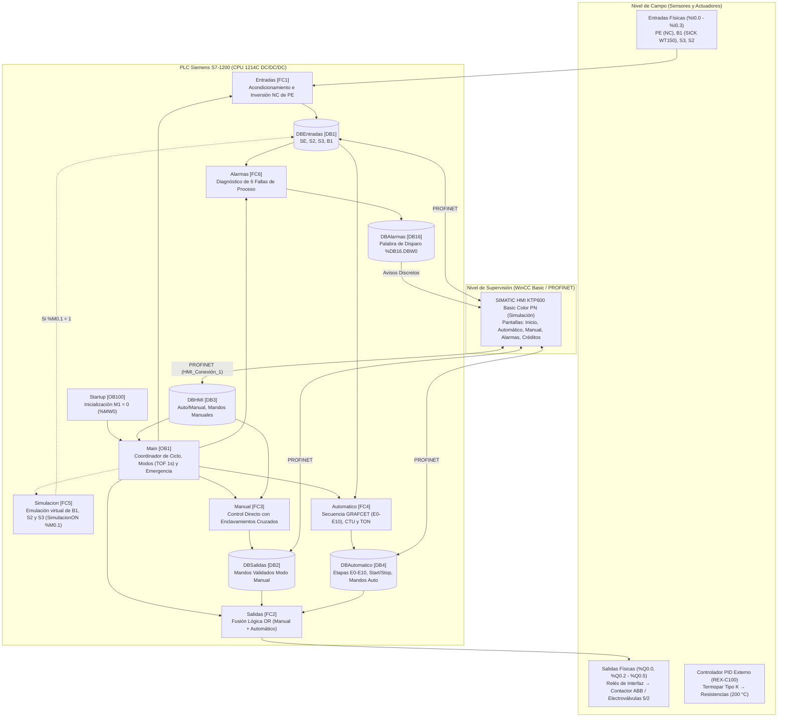
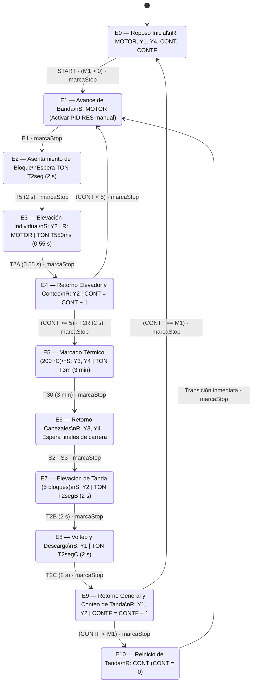

# 🏭 Repotenciación de Máquina Marcadora de Bloques con PLC Siemens S7-1200, GRAFCET e Interfaz HMI en TIA Portal

[](https://www.siemens.com/global/en/products/automation/industry-software/automation-software/tia-portal.html)
[](https://www.siemens.com/)
[](https://www.siemens.com/)
[-004666?style=for-the-badge&logo=siemens&logoColor=white)](https://www.siemens.com/global/en/products/automation/systems/industrial/plc/s7-1200.html)
[](https://www.siemens.com/)
[-IEC_61131--3-005A9C?style=for-the-badge)](https://webstore.iec.ch/publication/4552)
[](https://webstore.iec.ch/publication/3684)
[](https://www.profibus.com/technology/profinet)
[-D9534F?style=for-the-badge)](https://www.rkcinst.co.jp/)
[](https://www.sick.com/)
[](https://www.festo.com/)
[](https://www.sqlite.org/)
[](https://lucene.apache.org/)
[](https://www.iso.org/standard/69883.html)
[-1B365D?style=for-the-badge)](https://www.uceva.edu.co/)

---

## 📑 Tabla de Contenidos

1. [Descripción General y Problemática Inicial](#-descripción-general-y-problemática-inicial)
2. [Objetivos del Proyecto](#-objetivos-del-proyecto)
3. [Metodología de Repotenciación y Reacondicionamiento Físico](#-metodología-de-repotenciación-y-reacondicionamiento-físico)
4. [Especificaciones Técnicas y Hardware del Sistema](#️-especificaciones-técnicas-y-hardware-del-sistema)
5. [Funcionamiento Detallado y Arquitectura de Control](#-funcionamiento-detallado-y-arquitectura-de-control)
   - [Proceso Físico de Marcado por Tandas](#1-proceso-físico-de-marcado-por-tandas)
   - [Arquitectura Modular en TIA Portal V21](#2-arquitectura-modular-en-tia-portal-v21)
   - [Mapeo de Entradas, Salidas y Variables Internas](#3-mapeo-de-entradas-salidas-y-variables-internas)
   - [Modelado Secuencial GRAFCET y Traducción a Ladder](#4-modelado-secuencial-grafcet-y-traducción-a-ladder)
   - [Sistema de Diagnóstico y Alarmas (`FC6`)](#5-sistema-de-diagnóstico-y-alarmas-fc6)
   - [Interfaz Hombre-Máquina (SIMATIC HMI)](#6-interfaz-hombre-máquina-simatic-hmi)
6. [Pruebas, Validación y Resultados Clave](#-pruebas-validación-y-resultados-clave)
7. [Galería Técnica y Documentación Visual del Sistema](#-galería-técnica-y-documentación-visual-del-sistema)
8. [Requisitos Previos](#️-requisitos-previos)
9. [Instalación, Configuración y Despliegue](#-instalación-configuración-y-despliegue)
10. [Instrucciones de Uso y Operación](#-instrucciones-de-uso-y-operación)
11. [Árbol de Directorios del Repositorio](#-árbol-de-directorios-del-repositorio)
12. [Conclusiones y Trabajo Futuro](#-conclusiones-y-trabajo-futuro)
13. [Autores y Créditos](#-autores-y-créditos)

---

## 📋 Descripción General y Problemática Inicial

Este repositorio contiene el proyecto integral de ingeniería, software de automatización, configuración HMI y documentación técnica en formato IEEE para la **repotenciación tradicional (*retrofitting*)** de la máquina electroneumática marcadora de bloques (cubo pequeño) ubicada en el **Laboratorio de Automatización de la Unidad Central del Valle del Cauca (UCEVA)** en Tuluá, Colombia.

### Problemática Inicial (Antes de la Repotenciación)
Aunque la estructura mecánica de la estación se mantenía funcional y el PLC conservaba un programa de control antiguo, el prolongado tiempo de inactividad generó fallas críticas que impedían su operación confiable y su aprovechamiento académico:
1. **Deterioro del subsistema neumático:** Mangueras de poliuretano cristalizadas con fugas de presión, racores y acoples rápidos averiados o flojos, y un cilindro neumático atascado que no completaba su carrera de trabajo.
2. **Fallas en el subsistema térmico de marcado:** Cableado eléctrico deteriorado en varias de las resistencias calefactoras (`RES`) encargadas del pirograbado lateral de los bloques.
3. **Captadores sin continuidad eléctrica:** Pérdida de continuidad en los microinterruptores mecánicos de final de carrera (`S2` y `S3`) que confirman el retorno de los cabezales de marcado, sumada a problemas de desalineación mecánica en sus soportes.
4. **Ausencia total de documentación del tablero:** Inexistencia de planos eléctricos, rotulado o tablas de asignación de entradas y salidas (E/S) entre los elementos de campo, borneras, relés de interfaz y el PLC.
5. **Obsolescencia y rigidez del control lógico:** Se determinó descartar el programa anterior y desarrollar **desde cero** una nueva arquitectura modular en lenguaje **Ladder (LD — IEC 61131-3)** a partir de un diseño formal en **GRAFCET (IEC 60848)** sobre un **PLC Siemens SIMATIC S7-1200 (CPU 1214C DC/DC/DC)** en **TIA Portal V21**, incorporando modo manual con enclavamientos cruzados, modo automático por lotes (*tandas*) configurables, gemelo de simulación de entradas, paro de emergencia a prueba de fallos (**ISO 13850**) y un sistema de 6 alarmas de diagnóstico integradas con una interfaz **SIMATIC HMI**.

---

## 🎯 Objetivos del Proyecto

### Objetivo General
Repotenciar la máquina marcadora de bloques del Laboratorio de Automatización de la UCEVA mediante el reacondicionamiento físico de sus subsistemas electroneumático y eléctrico, el levantamiento y documentación del tablero de control, y el desarrollo desde cero de un sistema de control secuencial basado en GRAFCET e implementado en lenguaje Ladder sobre un PLC Siemens S7-1200 con supervisión mediante interfaz HMI en TIA Portal V21.

### Objetivos Específicos
1. **Diagnosticar y reacondicionar los componentes físicos** de la máquina, sustituyendo la tubería neumática cristalizada y los racores defectuosos, reparando el cilindro neumático averiado, renovando el cableado de las resistencias calefactoras y restableciendo la continuidad eléctrica de los finales de carrera `S2` y `S3`.
2. **Realizar el levantamiento del cableado del tablero eléctrico**, identificando y rotulando punto a punto la relación entre sensores, actuadores, borneras, fuentes de alimentación, contactor, relés de interfaz y las direcciones físicas de entrada/salida del PLC S7-1200.
3. **Diseñar la lógica secuencial del proceso mediante un diagrama GRAFCET de 11 etapas**, contemplando la acumulación de 5 bloques por tanda, el marcado térmico temporizado a 200 °C durante 3 minutos, la descarga por volteo y la repetición automática según el número de tandas (`M1`) programado por el operador.
4. **Implementar el programa de control en lenguaje Ladder (IEC 61131-3) en TIA Portal V21** bajo una arquitectura modular de bloques (`OB1`, `OB100`, `FC1`–`FC6` y bloques de datos globales `DB`), integrando modo automático, modo manual con enclavamientos de seguridad entre cilindros, modo de simulación sin hardware, paro normal con retención de etapa, paro de emergencia normalmente cerrado (NC) y detección de 6 alarmas operativas.
5. **Diseñar y validar una interfaz hombre-máquina (HMI) en WinCC Basic V21** con pantallas de inicio, operación automática con sinóptico animado, operación manual, visualización de alarmas y créditos para el control y monitoreo integral del proceso.

---

## 🛠️ Metodología de Repotenciación y Reacondicionamiento Físico

El proyecto se ejecutó en **siete fases metodológicas** dentro del Laboratorio de Automatización de la UCEVA:

1. **Diagnóstico inicial:** Inspección integral del programa previo, fuentes de 24 V DC, red de aire comprimido, sensores, actuadores y respuesta mecánica/eléctrica.
2. **Reacondicionamiento físico:** Intervención correctiva de los subsistemas neumático, térmico y de captación deteriorados por inactividad.
3. **Levantamiento y rotulado del tablero eléctrico:** Seguimiento con multímetro y prueba de continuidad de cada señal desde el elemento de campo hasta las borneras inferiores, relés de interfaz y canales del PLC S7-1200.
4. **Modelado formal en GRAFCET:** Definición de entradas, salidas, marcas internas, contadores y temporizadores, y construcción del GRAFCET de 11 etapas (`E0`–`E10`) con dos bifurcaciones por conteo.
5. **Programación modular en TIA Portal V21:** Codificación en Ladder (STEP 7 Basic V21) estructurada en `OB1`, `OB100`, `FC1`–`FC6` y bloques de datos globales, incluyendo el bloque `Simulacion [FC5]` para depuración virtual previa.
6. **Desarrollo de la interfaz HMI:** Creación en WinCC Basic V21 de 5 pantallas operativas con barra de navegación persistente.
7. **Pruebas y validación experimental:** Verificación individual de carreras y sensores en modo manual y ejecución de ciclos completos multi-tanda en modo automático con marcado térmico real a 200 °C.

### Resumen de Fallas Diagnosticadas y Acciones Correctivas Ejecutadas

| Subsistema / Elemento | Falla Diagnosticada | Acción Correctiva Ejecutada |
| :--- | :--- | :--- |
| **Tubería neumática** | Mangueras plásticas deterioradas y cristalizadas con fugas de aire comprimido | Reemplazo completo de los tramos de tubería de poliuretano afectados |
| **Racores y conectores** | Conexiones neumáticas rápidas averiadas o flojas | Reparación y sustitución de racores rápidos defectuosos |
| **Cilindro neumático** | Cilindro atascado/dañado que no completaba su carrera de trabajo | Desmontaje, mantenimiento y reparación mecánica del actuador |
| **Resistencias de marcado (`RES`)** | Cableado eléctrico dañado en varias resistencias calefactoras | Reemplazo del cableado y aislamiento térmico/eléctrico con tubo termoencogible |
| **Finales de carrera (`S2`, `S3`)** | Pérdida de continuidad eléctrica en los microinterruptores KW1-103 | Restablecimiento de conexiones eléctricas y verificación con multímetro y entradas del PLC |
| **Cableado del tablero** | Ausencia total de planos o documentación de entradas y salidas | Levantamiento punto a punto de señales y rotulado normalizado de relés y borneras |

---

## ⚙️ Especificaciones Técnicas y Hardware del Sistema

El sistema repotenciado conserva su estructura mecánica original e integra los siguientes componentes industriales identificados en el levantamiento de campo:

| Componente | Referencia y Características Técnicas | Función en el Sistema |
| :--- | :--- | :--- |
| **PLC (`A1`)** | **Siemens SIMATIC S7-1200, CPU 1214C DC/DC/DC** (`6ES7 214-1AG40-0XB0` FW V4.7 / `6ES7 214-1AG31-0XB0` FW V3.0); alimentación 24 V DC, 14 DI (24 V DC), 10 DQ de transistor (24 V DC), 2 AI (0–10 V), puerto PROFINET | Ejecuta el programa modular de control secuencial, enclavamientos, temporización, conteo y diagnóstico de alarmas |
| **Panel HMI (`P1`)** | **Siemens SIMATIC HMI KTP600 Basic Color PN** (`6AV6 647-0AD11-3AX0`, `LEAN06PNCOLOR`); pantalla TFT táctil de 6" con teclas `F1`–`F6` | Interfaz gráfica del operador (ejecutada en simulación WinCC Runtime desde PC conectado por PROFINET al PLC) |
| **Fuente Principal (`V1`)** | **Omron S8VE-06024**; entrada 100–240 V AC, salida 24 V DC / 2.5 A (60 W) | Alimentación principal de 24 V DC para el PLC y señales de control |
| **Fuente Auxiliar (`V2`)** | **Siemens LOGO!Power `6EP3331-6SB00-0AY0`**; salida estabilizada 24 V DC / 1.3 A | Alimentación auxiliar de 24 V DC en el nivel intermedio del tablero |
| **Protecciones (`F1`, `F2`)** | Interruptor termomagnético bipolar **People DZ47-63 C4** (`F1`) e interruptor monopolar **Siemens** (`F2`) | Protección magnetotérmica de las líneas de alimentación del gabinete |
| **Contactor de Potencia** | **ABB AF16-30-10-13** (`1SBL177001R1310`); tripolar (3 polos principales + 1 contacto auxiliar NA), bobina 100–250 V AC/DC | Conmutación de potencia del motor eléctrico de la banda transportadora |
| **Relés de Interfaz** | 6 módulos de relé sobre riel DIN rotulados: `Q0-MOTOR`, `Q2-Y4`, `Q3-Y2`, `Q4-Y1`, `Q5-Y3`, `I1-B1` | Aislamiento galvánico y acople de tensión entre el PLC (24 V DC) y las bobinas de campo/válvulas (110 V AC) |
| **Motor de Banda (`MOTOR`)** | Motor eléctrico acoplado a transportador de cadena | Traslada los bloques desde la entrada hasta la posición del sensor `B1` |
| **Sensor de Presencia (`B1`)** | **SICK WT150-N460** (`1436F`); sensor fotoeléctrico de proximidad por reflexión sobre objeto, 10–30 V DC, salida `<= 0.1 A`, selector `L.ON / D.ON` | Detecta sin contacto la llegada y presencia del bloque en la estación de elevación |
| **Finales de Carrera (`S2`, `S3`)** | Microinterruptores electromecánicos de palanca **KW1-103**; 15 A, 125/250 V AC | Confirman mecánicamente que los cabezales de marcado (`Y4` e `Y3`) regresaron a su posición de reposo |
| **Paro de Emergencia (`S1` / `PE`)** | Pulsador tipo hongo rojo con retención mecánica y liberación por giro, contacto normalmente cerrado (**NC**) | Parada de emergencia por hardware a prueba de fallos conforme a **ISO 13850** e **IEC 60204-1** |
| **Electroválvulas (`Y1`–`Y4`)** | 4 electroválvulas direccionales **5/2 vías monoestables** con retorno por resorte y silenciadores sinterizados (p. ej. **Pneutec PTV-280-4S1**, bobina 110 V AC, presión 0.15–1.0 MPa) | Conmutan el aire comprimido hacia las cámaras de avance y retroceso de los cuatro cilindros neumáticos |
| **Cilindro de Volteo (`Y1`)** | Cilindro neumático compacto de doble efecto **Festo** (instalado en la parte superior) | Voltea el compartimiento superior para descargar la tanda completa de 5 bloques marcados |
| **Cilindro Elevador (`Y2`)** | Cilindro neumático vertical de doble efecto (instalado bajo la estación de apilamiento) | Eleva individualmente cada bloque al compartimiento superior y eleva la columna de 5 bloques antes del volteo |
| **Cilindros de Marcado (`Y3`, `Y4`)** | Cilindros neumáticos compactos de doble efecto y doble vástago (guiados antirotación) **SNS TN16x50-S**; Ø16 mm, carrera 50 mm, presión máx. 1.0 MPa | Acercan lateralmente los dos cabezales calefactores con alta rigidez torsional para estampar los 5 bloques a la vez |
| **Controlador Térmico PID** | **RKC Instrument REX-C100 (`REX-C100FK02-M*AN DA`)**; alimentación 100–240 V AC (50/60 Hz), entrada termopar tipo K (`0–400 °C`), salida por relé (`RELAY`), displays `PV` y `SV` | Regula en lazo cerrado independiente la temperatura de los cabezales de marcado en la consigna de **200 °C** |
| **Resistencias de Marcado (`RES`)** | Juego de resistencias calefactoras encapsuladas en los bloques metálicos de los cabezales laterales | Ejecutan el pirograbado simultáneo de los 5 bloques apilados a **200 °C durante 3 minutos** |

---

## 🔄 Funcionamiento Detallado y Arquitectura de Control

### 1. Proceso Físico de Marcado por Tandas
La máquina opera procesando lotes denominados **tandas**, donde cada tanda está compuesta por **5 bloques**:
1. **Transporte y Detección (`E1`–`E2`):** Al iniciar el ciclo (`START`) con un número de tandas válido (`M1 > 0`), se enciende el motor de la banda transportadora (`MOTOR`) y el operador activa el controlador PID externo (`RES` a 200 °C). Cuando un bloque llega a la estación de trabajo, el sensor fotoeléctrico `B1` lo detecta y se aguarda un tiempo de asentamiento de **2 s** (`T5`).
2. **Elevación y Apilamiento Individual (`E3`–`E4`):** Se apaga el motor de la banda y la electroválvula `Y2` extiende el cilindro elevador vertical durante **0.55 s** (`T2A`), introduciendo el bloque en el compartimiento superior donde queda retenido. Al retraerse `Y2`, el contador de bloques `CONT` se incrementa en 1. Si `CONT < 5`, el ciclo regresa a `E1` para alimentar el siguiente bloque.
3. **Marcado Térmico Simultáneo (`E4` → `E5`):** Cuando se acumulan los **5 bloques** (`CONT >= 5`), un temporizador de seguridad de **2 s** (`T2R`) garantiza que el vástago del elevador `Y2` haya descendido por completo antes de avanzar los cabezales laterales. En `E5`, las electroválvulas `Y3` e `Y4` extienden simultáneamente los cilindros de doble vástago, presionando los cabezales calefactores a **200 °C** contra los 5 bloques durante **3 minutos (180 s)** (`T30`).
4. **Retorno de Cabezales (`E6`):** Finalizados los 3 minutos, se desenergizan `Y3` e `Y4` para que los cabezales retornen por resorte. La transición hacia la etapa de descarga exige la confirmación simultánea de los finales de carrera mecánicos **`S2` y `S3`**.
5. **Elevación de Columna y Descarga por Volteo (`E7`–`E9`):** Con los cabezales retraídos, `Y2` se activa durante **2 s** (`T2B`) para elevar el conjunto de 5 bloques marcados. A continuación, el cilindro superior `Y1` se activa durante **2 s** (`T2C`) para voltear el compartimiento y descargar la tanda. En `E9` se retraen `Y1` e `Y2` y se incrementa el contador de tandas `CONTF`.
6. **Repetición o Fin de Orden (`E9`–`E10` → `E0`):** Si `CONTF < M1`, se pasa por `E10` para reiniciar `CONT = 0` y comenzar la siguiente tanda en `E1`. Cuando `CONTF == M1`, la máquina finaliza la orden y retorna al estado de reposo `E0`.

---

### 2. Arquitectura Modular en TIA Portal V21

El software del PLC **SIMATIC S7-1200 (CPU 1214C DC/DC/DC)** se diseñó desacoplando por completo la periferia física (`%I` / `%Q`) de la lógica secuencial y manual mediante bloques de datos globales (`DB`):



#### Descripción de Bloques de Programa (`OB`, `FC` y `DB`)

| Bloque | Nombre Simbólico | Tipo / Lenguaje | Función Principal en la Arquitectura |
| :--- | :--- | :---: | :--- |
| **`OB1`** | `Main` | `OB` (`LAD`) | Ciclo principal: selecciona entre `Entradas [FC1]` y `Simulacion [FC5]` según `SimulacionON` (`%M0.1`), gestiona la transición entre modo Manual y Automático usando temporizadores `TOF` de **1 s** (`TimerManual`, `TimerAuto`) para limpiar bobinas al cambiar de modo, ejecuta el corte general por paro de emergencia (`"DBEntradas".SE`) e invoca `Salidas [FC2]` y `Alarmas [FC6]`. |
| **`OB100`** | `Startup` | `OB` (`LAD`) | Bloque de arranque en frío/tibio: ejecuta una instrucción `MOVE` que inicializa el número de tandas `M1 = 0` (`%MW0`) al energizar el PLC. |
| **`FC1`** | `Entradas` | `FC` (`LAD`) | Lee las entradas físicas `%I0.0`–`%I0.3` y las transfiere a `"DBEntradas"`. Invierte la lógica del contacto físico NC de paro de emergencia (`%I0.0`) para generar la señal interna activa en alto `"DBEntradas".SE`. |
| **`FC2`** | `Salidas` | `FC` (`LAD`) | Escritura centralizada hacia `%Q0.0` y `%Q0.2`–`%Q0.5`, combinando mediante ramas en paralelo (`OR`) los mandos de `"DBSalidas"` (modo manual) y `"DBAutomatico"` (modo automático). |
| **`FC3`** | `Manual` | `FC` (`LAD`) | Accionamiento individual de `MOTOR` e `Y1`–`Y4` desde la HMI con **enclavamientos cruzados de seguridad mecánica**: `Y2` solo puede activarse si `Y3` e `Y4` están desactivados ($\overline{Y3} \land \overline{Y4}$), e inversamente `Y3` e `Y4` solo pueden activarse si `Y2` está desactivado ($\overline{Y2}$). |
| **`FC4`** | `Automatico` | `FC` (`LAD`) | Implementación en Ladder de las 11 etapas del GRAFCET (`E0`–`E10`), control de `marcaStop` (`%M6.0`), acciones memorizadas por actuador, contadores `CTU` (`cont`, `contf`) y temporizadores `TON`. |
| **`FC5`** | `Simulacion` | `FC` (`LAD`) | Emulación virtual de sensores sin máquina física: cuando `E1` permanece activa por 5 s (`SimulacionE2`), activa `"DBEntradas".B1`; cuando `E6` permanece activa por 5 s (`SimulacionE7`), activa `"DBEntradas".S2` y `"DBEntradas".S3`. |
| **`FC6`** | `Alarmas` | `FC` (`LAD`) | Supervisión continua de condiciones anómalas y activación de las 6 alarmas de diagnóstico en `"DBAlarmas"` (`%DB16.DBW0`). |
| **`DB1`** | `DBEntradas` | `Global DB` | Imagen desacoplada de entradas: `SE` (`0.0`), `S2` (`0.1`), `S3` (`0.2`), `B1` (`0.3`). |
| **`DB2`** | `DBSalidas` | `Global DB` | Mandos validados del modo manual: `Motor` (`0.0`), `Y1` (`0.1`), `Y2` (`0.2`), `Y3` (`0.3`), `Y4` (`0.4`). |
| **`DB3`** | `DBHMI` | `Global DB` | Comandos táctiles desde la HMI: `Motor` (`0.0`), `Y1` (`0.1`), `Y2` (`0.2`), `Y3` (`0.3`), `Y4` (`0.4`), `Auto/Manual` (`0.5`). |
| **`DB4`** | `DBAutomatico` | `Global DB` | Estado del GRAFCET (`E0`–`E10`), comandos `Start`/`Stop`, salidas automáticas (`Motor`, `Y1`–`Y4`) y seguimiento de conteo. |
| **`DB16`** | `DBAlarmas` | `Global DB` | Palabra de disparo de avisos discretos (`%DB16.DBW0`) enlazada al visor de alarmas de WinCC HMI. |

---

### 3. Mapeo de Entradas, Salidas y Variables Internas

#### A. Entradas Físicas y Órdenes de Operador
| Símbolo | Tipo | Dirección / Variable TIA Portal | Bornera / Relé | Descripción |
| :--- | :--- | :--- | :--- | :--- |
| `PE` (`S1`) | Digital (NC) | `%I0.0` → `"DBEntradas".SE` | Bornera `I0-PE` | Paro de emergencia físico tipo hongo (contacto NC; leído negado como `SE` en `FC1`) |
| `B1` | Digital | `%I0.1` → `"DBEntradas".B1` | Relé `I1-B1` | Sensor fotoeléctrico SICK WT150-N460 de presencia de bloque en posición de trabajo |
| `S3` | Digital | `%I0.2` → `"DBEntradas".S3` | Bornera `I2-S3` | Final de carrera KW1-103 de reposo del cabezal izquierdo (lado cilindro `Y3`) |
| `S2` | Digital | `%I0.3` → `"DBEntradas".S2` | Bornera `I3-S2` | Final de carrera KW1-103 de reposo del cabezal derecho (lado cilindro `Y4`) |
| `START` | HMI (`Bool`) | `"DBAutomatico".Start` | PROFINET | Orden de inicio o reanudación del ciclo automático (activa `marcaStop`) |
| `STOP` | HMI (`Bool`) | `"DBAutomatico".Stop` | PROFINET | Parada normal del ciclo; detiene salidas conservando la etapa y contadores actuales |
| `Auto/Manual` | HMI (`Bool`) | `"DBHMI"."Auto/Manual"` | PROFINET | Selección del modo de operación desde la HMI (`0` = Manual, `1` = Automático) |
| `M1` | HMI (`Int`) | `%MW0` | PROFINET | Número de tandas de 5 bloques programadas por el operador |

#### B. Salidas Físicas y Actuadores
| Símbolo | Tipo | Dirección PLC | Relé / Etapa de Potencia | Descripción |
| :--- | :--- | :--- | :--- | :--- |
| `MOTOR` | Digital | `%Q0.0` | `Q0-MOTOR` + Contactor ABB `AF16-30-10-13` | Motor eléctrico de accionamiento de la banda transportadora de cadena |
| `Y4` | Digital | `%Q0.2` | `Q2-Y4` → Electroválvula 5/2 (110 V AC) | Cilindro de doble vástago SNS TN16x50-S del cabezal de marcado derecho (lado `S2`) |
| `Y2` | Digital | `%Q0.3` | `Q3-Y2` → Electroválvula 5/2 (110 V AC) | Cilindro elevador vertical (apilamiento individual y elevación conjunta de los 5 bloques) |
| `Y1` | Digital | `%Q0.4` | `Q4-Y1` → Electroválvula 5/2 (110 V AC) | Cilindro compacto Festo superior de volteo y descarga del compartimiento |
| `Y3` | Digital | `%Q0.5` | `Q5-Y3` → Electroválvula 5/2 (110 V AC) | Cilindro de doble vástago SNS TN16x50-S del cabezal de marcado izquierdo (lado `S3`) |
| `RES` | Manual (PID) | — | Controlador PID externo RKC REX-C100 | Resistencias calefactoras de marcado reguladas a **200 °C** |

> **Nota sobre el direccionamiento físico:** El canal `%Q0.1` no está utilizado en el cableado del gabinete; el levantamiento eléctrico documentó la asignación física `%Q0.0` (`MOTOR`), `%Q0.2` (`Y4`), `%Q0.3` (`Y2`), `%Q0.4` (`Y1`) y `%Q0.5` (`Y3`).

#### C. Variables Internas, Contadores y Temporizadores
| Símbolo | Tipo | Dirección / Instancia | Valor Preseleccionado | Descripción |
| :--- | :--- | :--- | :---: | :--- |
| `E0` … `E10` | `Bool` | `"DBAutomatico".E0` … `E10` | — | Bits de estado de las 11 etapas del GRAFCET |
| `marcaStop` | `Bool` | `%M6.0` | — | Marca de habilitación de marcha (`START` hace Set, `STOP` hace Reset) |
| `SimulacionON` | `Bool` | `%M0.1` | `FALSE` | Conmuta `OB1` entre la lectura de entradas reales (`FC1`) y el simulador (`FC5`) |
| `CONT` | `CTU` | `"cont"` (`DB5`) | `PV = 5` | Contador de bloques acumulados en la tanda actual (meta: 5 bloques) |
| `CONTF` | `CTU` | `"contf"` (`DB11`) | `PV = M1` | Contador de tandas completas marcadas y descargadas (meta: `M1`) |
| `cont_actual` | `Int` | `%MW2` | — | Copia del valor actual (`CV`) de `CONT` para visualización en la HMI |
| `contf_actual` | `Int` | `%MW4` | — | Copia del valor actual (`CV`) de `CONTF` para visualización en la HMI |
| `T5` (`T2seg`) | `TON` | `DB23` | `PT = 2 s` | Temporizador de asentamiento del bloque tras ser detectado por `B1` (Etapa `E2`) |
| `T2A` (`T550ms`) | `TON` | `DB6` | `PT = 0.55 s` | Temporizador de elevación individual del bloque con `Y2` (Etapa `E3`) |
| `T2R` | `TON` | `DB21` | `PT = 2 s` | Temporizador de espera en `E4` (`CONT >= 5`) para asegurar el descenso total de `Y2` antes de activar `Y3`/`Y4` |
| `T30` (`T3m`) | `TON` | `DB12` | `PT = 3 min` | Temporizador de marcado térmico con `Y3` e `Y4` extendidos a 200 °C (Etapa `E5`) |
| `T2B` (`T2segB`) | `TON` | `DB24` | `PT = 2 s` | Temporizador de elevación del conjunto de 5 bloques marcados con `Y2` (Etapa `E7`) |
| `T2C` (`T2segC`) | `TON` | `DB25` | `PT = 2 s` | Temporizador de accionamiento del cilindro de volteo `Y1` para descarga (Etapa `E8`) |

---

### 4. Modelado Secuencial GRAFCET y Traducción a Ladder

La secuencia se modeló bajo la norma **IEC 60848 (GRAFCET)** con 11 etapas (`E0`–`E10`) y se tradujo a lenguaje **Ladder (IEC 61131-3)** aplicando la ecuación general de autoenclavamiento por etapa condicionada por `marcaStop`:

$$E_i = \left( (E_{i-1} \cdot R_i \cdot \text{marcaStop}) + E_i \right) \cdot \overline{E_{i+1}}$$

Donde $E_i$ es la etapa actual, $E_{i-1}$ la etapa precedente, $R_i$ la condición de transición (receptividad) habilitada por `marcaStop`, y $E_{i+1}$ la etapa siguiente que desactiva a $E_i$. Gracias a esta estructura, cuando el operador pulsa **`STOP`** (`marcaStop = 0`), las salidas se desactivan de inmediato pero el término de retención $+ E_i$ conserva la etapa activa y el valor de los contadores hasta que se pulse nuevamente **`START`**.



#### Tabla de Etapas del GRAFCET (`Automatico [FC4]`)

| Etapa | Acciones Asociadas | Condición de Transición (Receptividad) | Temporizador (`PT`) |
| :---: | :--- | :--- | :---: |
| **`E0`** | `R`: `MOTOR`, `Y1`–`Y4`, `CONT`, `CONTF` (Estado inicial de reposo) | `START` $\cdot$ (`M1 > 0`) $\cdot$ `marcaStop` $\rightarrow$ `E1` | — |
| **`E1`** | `S`: `MOTOR` *(y activación manual de PID `RES`)* | `B1` $\cdot$ `marcaStop` $\rightarrow$ `E2` | — |
| **`E2`** | Asentamiento del bloque en posición de elevación | `T5` $\cdot$ `marcaStop` $\rightarrow$ `E3` | `T2seg` (`2 s`) |
| **`E3`** | `S`: `Y2`; `R`: `MOTOR` (Eleva bloque y detiene banda) | `T2A` $\cdot$ `marcaStop` $\rightarrow$ `E4` | `T550ms` (`0.55 s`) |
| **`E4`** | `R`: `Y2`; incrementa `CONT + 1` | • Rama 1: (`CONT < 5`) $\cdot$ `marcaStop` $\rightarrow$ `E1`<br>• Rama 2: (`CONT >= 5`) $\cdot$ `T2R` $\cdot$ `marcaStop` $\rightarrow$ `E5` | `T2R` (`2 s`) |
| **`E5`** | `S`: `Y3`, `Y4` (Cabezales marcan los 5 bloques simultáneamente) | `T30` $\cdot$ `marcaStop` $\rightarrow$ `E6` | `T3m` (`3 min`) |
| **`E6`** | `R`: `Y3`, `Y4` (Retorno de cabezales de marcado) | `S2` $\cdot$ `S3` $\cdot$ `marcaStop` $\rightarrow$ `E7` | — |
| **`E7`** | `S`: `Y2` (Eleva el conjunto de 5 bloques marcados) | `T2B` $\cdot$ `marcaStop` $\rightarrow$ `E8` | `T2segB` (`2 s`) |
| **`E8`** | `S`: `Y1` (Voltea el compartimiento para descargar la tanda) | `T2C` $\cdot$ `marcaStop` $\rightarrow$ `E9` | `T2segC` (`2 s`) |
| **`E9`** | `R`: `Y1`, `Y2`; incrementa `CONTF + 1` | • Rama 1: (`CONTF < M1`) $\cdot$ `marcaStop` $\rightarrow$ `E10`<br>• Rama 2: (`CONTF == M1`) $\cdot$ `marcaStop` $\rightarrow$ `E0` | — |
| **`E10`** | `R`: `CONT` (Reinicia contador de bloques para nueva tanda) | Inmediata (con `marcaStop`) $\rightarrow$ `E1` | — |

---

### 5. Sistema de Diagnóstico y Alarmas (`FC6`)

El bloque `Alarmas [FC6]` supervisa de forma continua seis condiciones de fallo operativo o de seguridad y actualiza la palabra `%DB16.DBW0` (`DBAlarmas`):

| # | Alarma en HMI | Bit en `DBAlarmas` | Condición Lógica de Activación | Diagnóstico / Significado Operativo |
| :-: | :--- | :---: | :--- | :--- |
| **1** | **`Stop emergencia`** | `%DB16.DBX0.0` | Señal `SE` activa (`%I0.0` abierto) | Pulsador físico de emergencia `S1` accionado o rotura de conductor en el lazo NC |
| **2** | **`Simultaneidad`** | `%DB16.DBX0.1` | Salida `Y2` activa simultáneamente con `Y3` o `Y4` | Riesgo de colisión mecánica entre el cilindro elevador y los cabezales de marcado |
| **3** | **`Fallo en B1`** (`Fallo en motor`) | `%DB16.DBX0.2` | Etapa `E1` activa y sensor `B1` inactivo durante más de **20 s** (`TB1`) | La banda transportadora está en marcha pero no llegan bloques a la estación (falta de piezas o falla en banda/sensor) |
| **4** | **`Fallo S2`** (`Fallo en valvulas S2`) | `%DB16.DBX0.3` | Salida `Y4` activa y final de carrera `S2` permanece activo | El cilindro `Y4` no avanzó o el microinterruptor `S2` quedó atascado/desalineado |
| **5** | **`Fallo S3`** (`Fallo en valvulas S3`) | `%DB16.DBX0.4` | Salida `Y3` activa y final de carrera `S3` permanece activo | El cilindro `Y3` no avanzó o el microinterruptor `S3` quedó atascado/desalineado |
| **6** | **`Atasco`** | `%DB16.DBX0.5` | Sensor `B1` permanece activo de forma continua durante **6 s** (`TAtasco`) | Un bloque quedó obstruido o detenido frente al sensor `B1` sin ser elevado por `Y2` |

---

### 6. Interfaz Hombre-Máquina (SIMATIC HMI)

La aplicación HMI fue diseñada en **WinCC Basic V21** para el panel **SIMATIC HMI KTP600 Basic Color PN** (`6AV6 647-0AD11-3AX0`) conectado por **PROFINET** (`HMI_Conexión_1`), estructurada en cinco vistas con una barra inferior de navegación común:
- **Pantalla Inicial:** Portada del proyecto con fecha y hora del sistema y acceso rápido a todos los modos.
- **Pantalla de Modo Automático:** Permite ingresar el número de tandas (`M1`), comandar el inicio (`START`) y parada (`STOP`) del proceso, observar los contadores en tiempo real (`Cantidad de bloques` y `Cantidad de tandas`) y monitorear un **sinóptico gráfico animado de la máquina** con pilotos luminosos sobre cada sensor y actuador (`MOTOR`, `Y1`–`Y4`, `B1`, `S2`, `S3`, `RES`).
- **Pantalla de Modo Manual:** Permite conmutar individualmente cada actuador (`MOTOR`, `Y1`, `Y2`, `Y3`, `Y4`) respetando los enclavamientos cruzados de `FC3`, y verificar el estado lógico en vivo de `B1`, `S2` y `S3` (rojo = inactivo, verde = activo).
- **Visor de Alarmas:** Ventana emergente (`AlarmView`) que registra las alarmas activas con código, marca de tiempo y estado de reconocimiento.
- **Pantalla de Créditos:** Presenta las fotografías y nombres de los cuatro autores del proyecto.

---

## 📊 Pruebas, Validación y Resultados Clave

1. **Recuperación del 100 % de las Carreras Neumáticas y Captadores:**
   - Tras sustituir las mangueras cristalizadas, reparar los racores y reacondicionar el cilindro averiado, los cuatro actuadores neumáticos (`Y1`–`Y4`) completaron el 100 % de su recorrido desde las pruebas en Modo Manual.
   - Se verificó la recepción confiable de los finales de carrera `S2` (`%I0.3`) y `S3` (`%I0.2`) en estado de reposo y del sensor fotoeléctrico `B1` (`%I0.1`) al paso de los bloques.
   - Se identificó que la vibración de ciclos repetitivos puede desalinear ocasionalmente los soportes mecánicos de `S2` y `S3`, lo que retendría el GRAFCET en la etapa `E6`; las alarmas **`Fallo S2`** y **`Fallo S3`** permiten diagnosticar de inmediato esta condición en planta.

2. **Caracterización Térmica y Tiempo de Ciclo por Tanda ($T_{\text{tanda}}$):**
   - Ajustando el controlador PID externo **RKC REX-C100 a 200 °C**, se comprobó experimentalmente que un tiempo de contacto de **3 minutos (180 s)** de los cabezales `Y3` e `Y4` garantiza un marcado nítido y uniforme en los 5 bloques simultáneamente, sin comprometer el aislamiento termoencogible del cableado de las resistencias.
   - El **tiempo fijo teórico por tanda ($T_{\text{tanda}}$)** determinado por la suma de los temporizadores del GRAFCET para apilar 5 bloques, marcarlos y descargarlos es:

$$T_{\text{tanda}} = 5(2 + 0.55) + 2 + 180 + 2 + 2 = 198.75\text{ s} \approx 3.31\text{ min}$$

   - La etapa de marcado térmico (`E5`, 180 s) representa el **90.6 %** del tiempo fijo del ciclo, siendo el factor determinante de la capacidad productiva de la estación (por ejemplo, una orden de $M1 = 2$ tandas = 10 bloques requiere al menos $6.62\text{ min}$ más los tiempos de traslado por banda).

---

## 📸 Galería Técnica y Documentación Visual del Sistema

A continuación se documentan la totalidad de los **16 recursos visuales** almacenados en la carpeta [`Imagenes/`](Imagenes/) del repositorio, organizados por subsistema técnico con su respectiva **Descripción** visual y **Función** dentro de la repotenciación de la marcadora de bloques.

---

### 1. Arquitectura General y Planta Física

#### 1.1. Esquema Funcional e Isométrico de la Máquina (`Imagenes/Diagrama maquina.png`)

- **Descripción:** Diagrama esquemático isométrico de la marcadora de bloques donde se identifica la disposición espacial de todos sus elementos activos y pasivos: el motor de arrastre (`MOTOR`) acoplado a la banda transportadora de cadena, el sensor fotoeléctrico de entrada de bloque (`B1`), el cilindro inferior de elevación con su electroválvula (`Y2`), los cilindros horizontales opuestos de estampado lateral (`Y3` e `Y4`), las resistencias calefactoras alojadas en los cabezales de marcado (`RES`), los finales de carrera asociados a los cabezales (`S2` y `S3`) y el cilindro superior de volteo/descarga (`Y1`).
- **Función:** Representar de forma integral el flujo mecánico y la arquitectura de instrumentación de la planta, sirviendo como plano de referencia tanto para el diseño secuencial del GRAFCET como para el sinóptico animado en la pantalla de Modo Automático de la HMI.

#### 1.2. Estación Mecánica y Electroneumática de Marcado (`Imagenes/Máquina 1.jpeg`)

- **Descripción:** Fotografía en primer plano del cabezal operativo de la máquina tras su reacondicionamiento. Se observan los cilindros neumáticos de aluminio (incluyendo el actuador superior `Y1` y los actuadores laterales), las mangueras renovadas de aire comprimido en poliuretano azul, los dos bloques metálicos enfrentados que alojan las resistencias térmicas de marcado con sus resortes de recuperación, el final de carrera lateral derecho, la señalización de seguridad industrial (*"RIESGO DE ATRAPAMIENTO"*) y el pulsador tipo hongo de parada de emergencia (`S1` - *"STOP DE EMERGENCIA"*).
- **Función:** Ejecutar la etapa física de apilamiento vertical, calentamiento, estampado térmico lateral simultáneo sobre la tanda de 5 bloques y posterior volteo de descarga, garantizando la parada inmediata por hardware mediante el contacto NC de `S1` ante cualquier condición de riesgo mecánico.

#### 1.3. Puesto de Trabajo Integrado en el Laboratorio de Automatización (`Imagenes/Máquina 2.jpeg`)

- **Descripción:** Fotografía panorámica de la estación de trabajo en el Laboratorio de Automatización de la UCEVA. Muestra la estructura mecánica de la marcadora en la parte inferior izquierda integrada con el pedestal vertical en acero inoxidable que aloja el panel táctil **Siemens SIMATIC HMI (`P1`)**, junto con el computador portátil de ingeniería conectado por PROFINET ejecutando TIA Portal V21 y la simulación en tiempo real de la HMI.
- **Función:** Integrar ergonómicamente la planta física con la estación de ingeniería y supervisión, permitiendo al operador parametrizar las tandas y vigilar el ciclo productivo a una distancia segura de la zona de atrapamiento y alta temperatura.

---

### 2. Subsistema de Control Eléctrico y Automatización (PLC)

#### 2.1. Tablero de Control, Potencia y PLC Rotulado (`Imagenes/Cableado 1.jpeg`)

- **Descripción:** Fotografía frontal del interior del gabinete eléctrico de control tras el levantamiento y rotulado normalizado, distribuido en tres niveles sobre riel DIN con canaletas ranuradas:
  - **Nivel Superior (*PROTECCIÓN / FUENTE / PLC*):** Interruptor termomagnético bipolar `F1` (People DZ47-63 C4), interruptor monopolar `F2` (Siemens), fuente conmutada principal `V1` Omron S8VE-06024 (`24 V DC / 2.5 A`) y controlador lógico programable **`A1` Siemens SIMATIC S7-1200 (CPU 1214C DC/DC/DC)** enlazado por PROFINET.
  - **Nivel Intermedio (*CONTACTOR / 110V / FUENTE / RELÉS*):** Contactor tripolar de potencia ABB (`AF16-30-10-13`), borneras de distribución de `110 V AC`, fuente auxiliar `V2` Siemens LOGO!Power (`24 V DC / 1.3 A`) y banco de 6 módulos de relés de interfaz rotulados como `Q0-MOTOR`, `Q2-Y4`, `Q3-Y2`, `Q4-Y1`, `Q5-Y3` e `I1-B1`.
  - **Nivel Inferior (*BORNERAS*):** Riel de borneras componibles de conexión hacia campo (incluyendo bornes identificados como `I0-PE`, `I2-S3`, `I3-S2`) y bornera de puesta a tierra (verde/amarillo).
- **Función:** Centralizar la protección magnetotérmica del sistema, la conversión y distribución de energía (`110 V AC` y `24 V DC`), el aislamiento galvánico entre las E/S a `24 V DC` del PLC y las cargas inductivas a `110 V AC` mediante relés de interfaz, y la ejecución cíclica del programa modular en el PLC S7-1200 (`A1`).

---

### 3. Subsistema de Control Térmico (Lazo PID Independiente)

#### 3.1. Panel Frontal del Controlador PID de Temperatura (`Imagenes/Controlador PID frontal.jpeg`)

- **Descripción:** Vista frontal del controlador digital de temperatura modelo **RKC REX-C100**, empotrado en el gabinete bajo el rótulo `"CONTROL TEMPERATURA"`. Dispone de doble display LED de 7 segmentos y 4 dígitos para visualizar simultáneamente el valor de proceso `PV` (*Process Value*) y el valor de consigna `SV` (*Set Value*), indicadores LED de estado (`ALM1`, `OUT1`, `ALM2`, `AT`) y teclado frontal de parametrización (`SET`, desplazamiento y flechas de ajuste).
- **Función:** Regular en lazo cerrado independiente (mediante control PID) la temperatura de las resistencias calefactoras (`RES`) de los cabezales de marcado en la consigna operativa de **200 °C**, asegurando un pirograbado uniforme sobre los cinco bloques de cada tanda.

#### 3.2. Placa de Especificaciones y Bornera del Controlador PID (`Imagenes/Controlador PID placa.jpeg`)

- **Descripción:** Vista lateral interna del controlador **REX-C100FK02-M\*AN DA** (RKC Instrument Inc.) donde se aprecian su placa de especificaciones técnicas y su bornera posterior cableada: rango de medición de **`0–400 °C` para termopar tipo K**, alimentación de `100–240 V AC (50/60 Hz)` en los terminales `1–2`, salida de control por relé (`OUTPUT: RELAY`) en los terminales `3–4`, salida de alarma `ALM1` en los terminales `6–7` y entrada de termopar en los terminales `9–10`.
- **Función:** Documentar la referencia exacta de hardware, el tipo de sensor térmico empleado (termopar tipo K hasta `400 °C`) y el esquema de conexión eléctrica que conmuta la etapa de calentamiento de las resistencias `RES`.

---

### 4. Subsistema Electroneumático (Actuadores y Válvulas)

#### 4.1. Cilindro Neumático Superior de Volteo `Y1` (`Imagenes/Cilindro Y1.jpeg`)

- **Descripción:** Fotografía en detalle del cilindro neumático compacto de doble efecto marca **FESTO**, identificado con la etiqueta **`Y1`**, equipado con dos racores rápidos superiores conectados a tubería neumática de poliuretano azul para las cámaras de avance y retroceso.
- **Función:** Actuar como elemento final de control lineal (`Y1`, comandado por la salida `%Q0.4` a través del relé `Q4-Y1`) encargado de voltear el compartimiento superior durante 2 segundos en la etapa `E8` para evacuar la tanda de 5 bloques ya marcados.

#### 4.2. Cilindro Neumático Guiado de Marcado `Y4` (`Imagenes/Cilindro Y4.jpeg`)

- **Descripción:** Vista lateral del cilindro neumático compacto de doble efecto y doble vástago (guiado antirotación) identificado como **`Y4`**, marca **SNS CYLINDER**, referencia **`TN 16X50-S`** (diámetro de émbolo de `16 mm`, carrera de `50 mm`, presión máxima de operación de `1.0 MPa` / `10.2 Kgf/cm²`), acoplado mecánicamente al cabezal porta-resistencias derecho.
- **Función:** Proporcionar empuje lineal guiado con alta rigidez frente a cargas laterales (`Y4`, activado mediante `%Q0.2` y `Q2-Y4`) para presionar perpendicularmente el cabezal calefactor derecho contra la columna de 5 bloques durante los 3 minutos de la etapa de marcado `E5`.

#### 4.3. Electroválvula Direccional 5/2 Vías `Y2` (`Imagenes/Electroválvula Y2.jpeg`)

- **Descripción:** Fotografía en primer plano de la electroválvula neumática direccional de 5/2 vías monoestable con retorno por resorte rotulada como **`Y2`** (serie **Pneutec PTV-280-4S1**). Se distingue la bobina solenoide superior de `110 V AC` con conector eléctrico translúcido norma DIN (marca MPM) e indicador luminoso, el cuerpo metálico de distribución con racor de alimentación de presión a la izquierda, dos silenciadores de escape de bronce sinterizado (`R1` y `R2`) y las dos vías de salida hacia el cilindro a la derecha.
- **Función:** Conmutar el flujo de aire comprimido hacia las cámaras del cilindro elevador vertical `Y2` en respuesta a la señal del PLC (`%Q0.3` vía relé `Q3-Y2`), gobernando tanto el apilamiento individual de cada bloque (`E3`, 0.55 s) como la elevación conjunta de la tanda de 5 bloques marcados antes de su descarga (`E7`, 2 s).

---

### 5. Subsistema de Instrumentación y Sensórica de Campo

#### 5.1. Sensor Fotoeléctrico de Presencia de Bloque `B1` (`Imagenes/Sensor B1.jpeg`)

- **Descripción:** Macrofotografía del sensor fotoeléctrico de proximidad por reflexión sobre objeto identificado como **`B1`**, marca **SICK**, referencia **`WT150-N460` (`1436F`)**, fijado mediante escuadra metálica junto al riel de la cadena transportadora y conectado con cable industrial naranja de conector circular M8. En su carcasa azul se observa el diagrama eléctrico grabado: alimentación `10...30 V DC` (`L+` y `M 0V`), salida digital `Q OUT <= 0.1 A` y selector de modo `L.ON / D.ON`.
- **Función:** Detectar sin contacto físico la llegada y permanencia de cada bloque en la posición de trabajo, enviando la señal digital al PLC (`%I0.1` a través del relé `I1-B1`) para disparar la transición `E1 → E2` del GRAFCET y alimentar la lógica de diagnóstico de las alarmas **`Fallo en B1`** (20 s sin llegada de bloques) y **`Atasco`** (6 s de obstrucción continua).

#### 5.2. Final de Carrera Electromecánico `S3` (`Imagenes/Final de carrera S3.jpeg`)

- **Descripción:** Fotografía de detalle del microinterruptor (*microswitch*) electromecánico de acción rápida con palanca metálica, etiquetado como **`S3`** (referencia **KW1-103**, 15 A, 125/250 V AC, certificaciones UL/CE), atornillado sobre la placa soporte junto al mecanismo móvil del cabezal de marcado izquierdo (`Y3`).
- **Función:** Suministrar realimentación digital de posición al PLC (`%I0.2`, bornera `I2-S3`) para confirmar mecánicamente que el cabezal calefactor izquierdo ha retornado por completo a su posición de reposo tras el marcado, habilitando junto con `S2` la transición segura `E6 → E7` y el monitoreo de la alarma **`Fallo S3`**.

---

### 6. Interfaz Hombre-Máquina (Siemens SIMATIC HMI) y Equipo Desarrollador

#### 6.1. Pantalla de Inicio de la HMI (`Imagenes/Pantalla inicial.jpeg`)

- **Descripción:** Captura de la pantalla de bienvenida del panel **Siemens SIMATIC HMI KTP600 Basic Color PN**, con el título central **"Repotenciación de máquina / Marcadora de cubo pequeño"**, encabezado con logotipo de Siemens, reloj del sistema en tiempo real (`11/13/2026 11:54:07 AM`), barra inferior de navegación persistente (*Alarmas*, *Inicio*, `MAN`, `AUTO`, `CRED`, *Salir de Runtime*) y marco del panel con teclas `F1` a `F6`.
- **Función:** Servir como menú principal de recepción del operador al iniciar el Runtime de la HMI, permitiendo navegar de forma directa hacia los modos de operación (`MAN` y `AUTO`), el visor de alarmas y la pantalla de créditos.

#### 6.2. Pantalla de Operación en Modo Automático (`Imagenes/Modo automático.jpeg`)

- **Descripción:** Captura de la vista **"MODO AUTOMÁTICO"** durante la ejecución real de una orden de producción. Integra a la izquierda el campo de entrada numérica de consigna (`"Inserte el número de tandas: +2"`), el recuadro de contadores en vivo (`"Cantidad de bloques: +5"` y `"Cantidad de tandas: +0"`), los botones táctiles de mando **`START`** (verde) y **`STOP`** (rojo), y a la derecha el **sinóptico gráfico de la máquina** con indicadores luminosos dinámicos (mostrando `Y3` e `Y4` iluminados en verde durante la etapa `E5` de marcado térmico de los 5 bloques apilados).
- **Función:** Permitir al operador configurar el tamaño del lote por número de tandas (`M1`), gobernar la marcha y parada normal del ciclo automático y supervisar visualmente en tiempo real tanto las variables de conteo (`CONT` y `CONTF`) como el estado activo/inactivo de cada sensor y actuador de la máquina.

#### 6.3. Pantalla de Operación y Diagnóstico en Modo Manual (`Imagenes/Modo manual.jpeg`)

- **Descripción:** Captura de la vista **"MODO MANUAL"** en el panel SIMATIC HMI en estado de reposo. Presenta una matriz de pulsadores e indicadores luminosos circulares distribuidos en dos columnas: a la izquierda los actuadores `MOTOR`, `Y1`, `Y2` e `Y3` (en color rojo = desactivados) y a la derecha el actuador `Y4` junto con los sensores `B1` (en rojo = sin pieza) y los finales de carrera `S2` y `S3` (iluminados en verde confirmando que los cabezales de marcado están retraídos).
- **Función:** Facilitar las tareas de mantenimiento, verificación de carrera, despeje de piezas y diagnóstico de sensores, permitiendo accionar individualmente cada actuador desde la pantalla táctil bajo la protección de los enclavamientos cruzados programados en `Manual [FC3]`.

#### 6.4. Pantalla HMI de Créditos del Proyecto (`Imagenes/Pantalla de créditos.jpeg`)

- **Descripción:** Captura de la pantalla **"CRÉDITOS"** integrada en la aplicación SIMATIC HMI, donde se visualizan los retratos, nombres completos y filiación académica (*"Estudiantes de Ingeniería Electrónica"*) de los cuatro desarrolladores del proyecto: **Liceth Tatiana Bolaños Cardona**, **Alejandro González Rico**, **Samuel David Guevara Quiñones** y **Juan David Serrato Vanegas**.
- **Función:** Acreditar dentro del propio software de supervisión industrial del panel HMI la autoría intelectual y técnica del equipo encargado de la repotenciación.

#### 6.5. Retratos Oficiales del Equipo Desarrollador (`Imagenes/Creditos.png`)

- **Descripción:** Composición gráfica horizontal en alta resolución con los retratos formales de los cuatro estudiantes de Ingeniería Electrónica de la UCEVA autores del proyecto (de izquierda a derecha: Liceth Tatiana Bolaños Cardona, Alejandro González Rico, Samuel David Guevara Quiñones y Juan David Serrato Vanegas).
- **Función:** Servir como activo gráfico maestro de identificación del equipo de ingeniería tanto para su integración en la vista `"CRÉDITOS"` de WinCC Basic como para la documentación oficial del repositorio.

---

## 🛠️ Requisitos Previos

### Requisitos de Software
* **Sistema Operativo:** Microsoft Windows 10 / Windows 11 (64 bits, ediciones Professional o Enterprise).
* **Suite de Ingeniería Siemens (Versión exacta registrada en [`ProjectInfo.txt`](ProjectInfo.txt)):**
  * **Totally Integrated Automation Portal (TIA Portal):** `V21.0` (`TechnicalVersion: 21.00.00.00`).
  * **SIMATIC STEP 7 Basic:** `V21.0` (`21.00.00.00`).
  * **SIMATIC WinCC Basic:** `V21.0` (`21.00.00.00`) con simulador **WinCC Runtime (`HmiSRT`)**.
  * *(Opcional para pruebas sin PLC físico)* **SIMATIC S7-PLCSIM V21**.

### Requisitos de Hardware (Operación en Planta)
* **PLC (`A1`):** Siemens SIMATIC S7-1200, **CPU 1214C DC/DC/DC** (`6ES7 214-1AG40-0XB0` FW V4.7 o `6ES7 214-1AG31-0XB0` FW V3.0).
* **Estación HMI / PC:** Panel **SIMATIC HMI KTP600 Basic Color PN** (`6AV6 647-0AD11-3AX0`) o PC con interfaz Ethernet RJ45 conectado a la red PROFINET del PLC.
* **Suministro Eléctrico:** Red monofásica de **110–120 V AC / 60 Hz** para alimentar las fuentes de 24 V DC (`Omron S8VE-06024` y `Siemens LOGO!Power`), el contactor ABB, las bobinas de `110 V AC` de las electroválvulas 5/2 y el controlador PID.
* **Suministro Neumático:** Red de aire comprimido filtrada y regulada entre **0.15 MPa y 1.0 MPa** (presión nominal recomendada: **0.6 MPa / ~6 bar / 87 PSI**).
* **Control Térmico:** Controlador PID **RKC REX-C100 (`REX-C100FK02-M*AN DA`)** con termopar tipo K y resistencias calefactoras operativas.

---

## 🚀 Instalación, Configuración y Despliegue

### 1. Clonar el Repositorio
```powershell
git clone https://github.com/JSerr5/repotenciacionMarcadoraBloques.git
cd repotenciacionMarcadoraBloques
```

### 2. Abrir el Proyecto en Siemens TIA Portal V21
1. Inicie **Siemens TIA Portal V21**.
2. En la vista del portal, seleccione **Abrir proyecto existente** (*Open existing project*) $\rightarrow$ **Examinar** (*Browse*).
3. Seleccione el archivo raíz [`proyecto-Repotenciacion.ap21`](proyecto-Repotenciacion.ap21) y cambie a la **Vista del proyecto** (*Project view*).

### 3. Configurar la Red PROFINET (PC $\leftrightarrow$ PLC S7-1200)
1. Conecte un cable Ethernet Cat 5e/6 entre el puerto RJ45 del PC y el puerto PROFINET (`X1 P1`) de la **CPU 1214C DC/DC/DC**.
2. Configure la tarjeta de red Ethernet de Windows dentro de la subred `192.168.0.x`:
   - **Dirección IP del PC:** `192.168.0.100`
   - **Máscara de subred:** `255.255.255.0`
   - *(Direcciones configuradas en el proyecto TIA Portal: `192.168.0.1` y `192.168.0.3`)*.
3. En el Panel de Control de Windows $\rightarrow$ **Ajustar interfaz PG/PC** (*Set PG/PC Interface*), asigne el punto de acceso `S7ONLINE (STEP 7)` a su adaptador Ethernet físico en modo `TCP/IP`.

### 4. Compilar y Cargar el Programa en el PLC
1. En el árbol del proyecto, haga clic derecho sobre `PLC_2 [CPU 1214C DC/DC/DC]` y seleccione **Compilar $\rightarrow$ Hardware y software (solo cambios)**.
2. Pulse el botón **Cargar en dispositivo** (*Download to device*), busque el PLC en la subred PROFINET y transfiera todos los bloques (`OB1`, `OB100`, `FC1`–`FC6` y bloques de datos `DB`).
3. Al finalizar la carga, marque **Arrancar módulo** (*Start module*) para colocar la CPU en modo **RUN**.

### 5. Ejecutar la Interfaz HMI en Simulación Conectada al PLC Real
1. En el árbol del proyecto de TIA Portal, seleccione la estación **`HMI_1 [KTP600 Basic color PN]`**.
2. Haga clic en el ícono **Iniciar simulación** (*Start simulation*) en la barra de herramientas superior.
3. Se abrirá el entorno **WinCC Runtime / Simulation** cargando el archivo compilado [`IM/HMI/S/0/Generates/pdata.srt`](IM/HMI/S/0/Generates/pdata.srt) y enlazándose en tiempo real con el PLC físico a través de la conexión PROFINET `HMI_Conexión_1`.

### 6. (Opcional) Prueba Virtual con el Bloque de Simulación (`FC5`)
Para validar la secuencia GRAFCET sin sensores físicos ni aire comprimido:
1. Active la observación online de `Main [OB1]` en TIA Portal.
2. Modifique la marca global **`"SimulacionON"` (`%M0.1`) a `TRUE` (`1`)**.
3. `OB1` deshabilitará `Entradas [FC1]` y ejecutará `Simulacion [FC5]`, el cual emulará automáticamente la llegada de bloques a `B1` y la activación de `S2` y `S3` mediante temporizadores de 5 segundos.
> ⚠️ **Advertencia:** Antes de operar la máquina física, asegúrese de restituir **`"SimulacionON"` (`%M0.1`) a `FALSE` (`0`)**.

---

## 🎮 Instrucciones de Uso y Operación

### 1. Verificación Previa al Arranque
1. **Aire Comprimido:** Abra la válvula de suministro neumático y verifique que los cilindros `Y1`–`Y4` se encuentren retraídos en reposo.
2. **Finales de Carrera `S2` y `S3`:** Compruebe que los microinterruptores mecánicos `S2` y `S3` estén debidamente alineados y accionados por los cabezales retraídos.
3. **Paro de Emergencia (`S1`):** Verifique que el botón tipo hongo `S1` esté desenclavado.
4. **Calentamiento de Cabezales (`RES`):** Encienda el controlador PID externo **RKC REX-C100**, confirme que la consigna `SV` esté en **200 °C** y aguarde a que la temperatura real `PV` se estabilice en 200 °C.

### 2. Pruebas en Modo Manual (`MAN`)
1. Pulse el botón **`MAN`** en la barra inferior de la HMI.
2. Verifique que los pilotos **`S2`** y **`S3`** estén en **verde** (activos) y **`B1`** en **rojo** (libre).
3. Accione individualmente **`MOTOR`**, **`Y1`**, **`Y2`**, **`Y3`** e **`Y4`** para comprobar el movimiento libre de cada elemento.
   - Los enclavamientos cruzados de `Manual [FC3]` impedirán activar `Y2` mientras `Y3` o `Y4` estén activos (y viceversa) para evitar colisiones mecánicas.
4. Desactive todos los mandos manuales antes de pasar a modo automático.

### 3. Producción en Modo Automático (`AUTO`)
1. Pulse el botón **`AUTO`** en la barra inferior de la HMI.
2. En el campo **`Inserte el número de tandas`**, ingrese la cantidad de tandas deseada (`M1 > 0`, donde cada tanda procesa **5 bloques**).
3. Alimente bloques al inicio de la banda transportadora y presione **`START`**.
4. Supervise el avance en el sinóptico animado y en los indicadores **`Cantidad de bloques`** (`0` a `5`) y **`Cantidad de tandas`** (`0` a `M1`). Al completarse las `M1` tandas, la máquina retornará automáticamente a reposo (`E0`).

### 4. Parada Normal (`STOP`) vs. Parada de Emergencia (`S1`)
* **Parada Normal (`STOP` en HMI):** Detiene inmediatamente el motor y retrae los cilindros activos, pero **retiene la etapa actual del GRAFCET y los valores de `CONT` y `CONTF`**. Al pulsar **`START`**, el ciclo continúa exactamente desde la etapa donde se pausó.
* **Parada de Emergencia (`S1` físico):** Desenergiza todas las salidas, activa la alarma **`Stop emergencia`** y **reinicia la secuencia a la etapa inicial `E0`** (poniendo los contadores a cero). Para reanudar: elimine la causa de riesgo, retire manualmente los bloques acumulados en el compartimiento, desenclave el pulsador `S1`, reconozca la alarma en la HMI y presione **`START`**.

---

## 📂 Árbol de Directorios del Repositorio

```text
repotenciacionMarcadoraBloques/
├── 📄 proyecto-Repotenciacion.ap21                  # Archivo raíz del proyecto de ingeniería en Siemens TIA Portal V21.0 (XML)
├── 📄 ProjectInfo.txt                               # Metadatos de versión del proyecto (TIA Portal V21, STEP 7 Basic V21, WinCC Basic V21)
├── 📄 Informe_Repotenciacion_Marcadora_IEEE.docx    # Informe técnico completo en formato IEEE (marco teórico, GRAFCET, tablas y anexos Ladder)
├── 📄 README.md                                     # Documentación técnica integral del repositorio
│
├── 📁 System/                                       # Base de datos central de ingeniería del proyecto TIA Portal (Persistence Engine)
│   ├── 📄 PEData.plf                                # Contenedor comprimido con la configuración de hardware (CPU 1214C, KTP600) y bloques (OB/FC/DB)
│   └── 📄 PEData.idx                                # Índice binario de acceso rápido a los objetos de PEData.plf
│
├── 📁 IM/                                           # Datos intermedios, compilación de Runtime HMI e índices de búsqueda de TIA Portal
│   ├── 📁 HMI/                                      # Configuración y compilación de la estación SIMATIC HMI (KTP600 Basic Color PN)
│   │   ├── 📄 BrokerInfo.dat                        # Metadatos del broker de comunicación HMI
│   │   ├── 📄 DeviceFolders.dat                     # Registro de rutas de dispositivos HMI del proyecto
│   │   └── 📁 S/0/                                  # Instancia del dispositivo HMI_1 (LEAN06PNCOLOR / KTP600 Basic Color PN)
│   │       ├── 📄 RtData.plf                        # Base de datos gráfica de WinCC (pantallas, tags, alarmas, conexiones PROFINET)
│   │       ├── 📄 RtData.idx                        # Índice de objetos de RtData.plf
│   │       ├── 📄 intermediate.dti                  # Metadatos de compilación intermedia del panel HMI
│   │       └── 📁 Generates/                        # Archivos compilados listos para ejecución en el simulador WinCC Runtime
│   │           ├── 📄 HmiSRT.ini                    # Parámetros de ventana del simulador WinCC Runtime (HmiSRT)
│   │           ├── 📄 pdata.files                   # Manifiesto XML de transferencia del proyecto HMI
│   │           ├── 📄 pdata.srt                     # Aplicación HMI compilada ejecutable por WinCC Runtime / Simulation
│   │           ├── 📄 pdata.pwx                     # Archivo compilado de administración de permisos y usuarios HMI
│   │           ├── 📄 pdata.ETH0.cnk                # Configuración compilada de la interfaz Ethernet/PROFINET (ETH0)
│   │           ├── 📄 pdata.ORIE.cnk                # Configuración de orientación de pantalla del panel
│   │           └── 📁 SimWork/                      # Directorio de trabajo en tiempo de ejecución del simulador HMI (incluye buffer @MSG)
│   ├── 📁 SPL/                                      # Preferencias de sesión del editor Ladder de TIA Portal
│   │   └── 📄 options.json                          # Estado visual de segmentos y bloques abiertos en el editor
│   └── 📁 SearchIndex/                              # Índice Apache Lucene (v3.0.3) generado por TIA Portal para búsqueda rápida de símbolos
│
├── 📁 XRef/                                         # Sistema de Referencias Cruzadas (Cross-Reference) de TIA Portal
│   └── 📄 XRef.db                                   # Base de datos SQLite 3 con el grafo de uso de variables (%I, %Q, %M, DB) y bloques
│
├── 📁 Vci/                                          # Interfaz de Control de Versiones (Version Control Interface) de TIA Portal
│   └── 📄 Vci.db                                    # Base de datos SQLite 3 para sincronización con control de versiones
│
├── 📁 AdditionalFiles/                              # Archivos complementarios de gestión y archivo de PLC
│   └── 📁 PLCM/
│       └── 📄 plcmArchive.pma15_0                   # Archivo de respaldo de gestión de conversión de PLC
│
└── 📁 Imagenes/                                     # Galería completa de 16 recursos visuales (hardware, tablero, sensores, actuadores y HMI)
    ├── 🖼️ Cableado 1.jpeg                           # Interior del tablero eléctrico rotulado (F1/F2, Fuentes V1/V2, PLC A1, Contactor ABB, Relés y Borneras)
    ├── 🖼️ Cilindro Y1.jpeg                          # Cilindro neumático compacto Festo de doble efecto (volteo/descarga superior)
    ├── 🖼️ Cilindro Y4.jpeg                          # Cilindro neumático de doble vástago SNS TN16x50-S (cabezal de marcado térmico derecho)
    ├── 🖼️ Controlador PID frontal.jpeg              # Panel frontal del controlador digital de temperatura RKC REX-C100
    ├── 🖼️ Controlador PID placa.jpeg                # Placa lateral y conexionado del controlador PID REX-C100FK02-M*AN DA (0-400 °C Tipo K)
    ├── 🖼️ Creditos.png                              # Composición fotográfica en alta resolución de los 4 autores del proyecto
    ├── 🖼️ Diagrama maquina.png                      # Esquema isométrico funcional de la máquina con ubicación de sensores y actuadores
    ├── 🖼️ Electroválvula Y2.jpeg                    # Electroválvula direccional 5/2 monoestable Pneutec PTV-280-4S1 (bobina 110 V AC)
    ├── 🖼️ Final de carrera S3.jpeg                  # Microinterruptor mecánico de palanca KW1-103 en el cabezal izquierdo
    ├── 🖼️ Modo automático.jpeg                      # Captura de la pantalla HMI "MODO AUTOMÁTICO" con sinóptico animado en operación
    ├── 🖼️ Modo manual.jpeg                          # Captura de la pantalla HMI "MODO MANUAL" con estado de actuadores y sensores
    ├── 🖼️ Máquina 1.jpeg                            # Vista superior del cabezal electroneumático de marcado y paro de emergencia S1
    ├── 🖼️ Máquina 2.jpeg                            # Vista general de la estación repotenciada con pedestal HMI y PC de ingeniería
    ├── 🖼️ Pantalla de créditos.jpeg                 # Captura de la pantalla HMI "CRÉDITOS" con los integrantes del equipo
    ├── 🖼️ Pantalla inicial.jpeg                     # Captura de la pantalla HMI de bienvenida ("Repotenciación de máquina - Marcadora de cubo pequeño")
    └── 🖼️ Sensor B1.jpeg                            # Sensor fotoeléctrico de proximidad SICK WT150-N460 instalado en la banda transportadora
```

---

## 📌 Conclusiones y Trabajo Futuro

### Conclusiones
1. **Recuperación Funcional Integral (*Retrofitting*):** La repotenciación permitió restablecer el 100 % de la operatividad mecánica, neumática, térmica y eléctrica de la máquina marcadora de bloques del Laboratorio de Automatización de la UCEVA sin alterar su estructura mecánica, sustituyendo una lógica obsoleta por un programa nuevo, documentado y modular.
2. **Levantamiento y Normalización del Tablero Eléctrico:** El seguimiento punto a punto y el rotulado de fuentes, protecciones, contactor, relés de interfaz y borneras permitieron documentar por completo el mapeo entre el campo y el PLC S7-1200, facilitando futuras prácticas y labores de mantenimiento.
3. **Solidez del Diseño GRAFCET a Ladder Modular:** El modelado en GRAFCET de 11 etapas brindó una especificación formal que se tradujo limpiamente a ecuaciones de autoenclavamiento en Ladder, mientras que la arquitectura desacoplada (`OB1`, `OB100`, `FC1`–`FC6` y bloques `DB`) permitió validar la lógica en simulación (`FC5`) antes de accionar los elementos neumáticos reales.
4. **Seguridad Operativa y Diagnóstico Industrial:** Los enclavamientos cruzados en modo manual entre el elevador `Y2` y los cabezales `Y3`/`Y4`, el paro de emergencia NC a prueba de fallos (ISO 13850) y las 6 alarmas programadas en `FC6` protegen la integridad mecánica de la estación y agilizan la detección de fallas como desalineación en `S2`/`S3` o atascos en `B1`.
5. **Validación del Marcado Térmico:** Se demostró experimentalmente que una consigna de **200 °C durante 3 minutos** en el controlador PID externo REX-C100 produce un marcado uniforme de los 5 bloques por tanda, representando el 90.6 % del tiempo fijo del ciclo ($198.75\text{ s}$).

### Recomendaciones y Trabajo Futuro
- **Transferencia Directa al Panel HMI Físico (`P1`):** Adecuar la versión de imagen de dispositivo/firmware del panel SIMATIC en TIA Portal para descargar la interfaz directamente en el hardware empotrado en el pedestal y prescindir del PC externo.
- **Temporizadores con Retención (`TONR`):** Sustituir las instrucciones `TON` por temporizadores acumulativos `TONR` condicionados por `marcaStop`, conservando el tiempo parcial transcurrido si el operador presiona `STOP` a mitad del marcado térmico.
- **Rigidización Mecánica de `S2` y `S3`:** Rediseñar los soportes de montaje de los finales de carrera `S2` y `S3` para evitar desalineaciones por vibración tras múltiples ciclos.
- **Aislamiento Térmico de Alta Temperatura:** Reemplazar el aislamiento termoencogible de las conexiones de las resistencias por fundas de fibra de vidrio o silicona de alta temperatura, posibilitando incrementar la consigna térmica para reducir el tiempo de marcado de 3 minutos.
- **Integración del PID al PLC y Evacuación Automática:** Conectar el encendido y la señal de temperatura lista del controlador PID REX-C100 al PLC S7-1200 e incorporar una subrutina automática de vaciado del compartimiento tras un paro de emergencia.

---

## 👥 Autores y Créditos

Proyecto desarrollado por estudiantes del **Programa de Ingeniería Electrónica** de la **Facultad de Ingenierías** de la **Unidad Central del Valle del Cauca (UCEVA)** — Tuluá, Valle del Cauca, Colombia (Noviembre de 2026).

| Integrante | Rol / Programa Académico |
| :--- | :--- |
| **Liceth Tatiana Bolaños Cardona** | Estudiante de Ingeniería Electrónica — UCEVA |
| **Alejandro González Rico** | Estudiante de Ingeniería Electrónica — UCEVA |
| **Samuel David Guevara Quiñones** | Estudiante de Ingeniería Electrónica — UCEVA |
| **Juan David Serrato Vanegas** | Estudiante de Ingeniería Electrónica — UCEVA |

### 🎓 Información Académica
- **Institución:** Unidad Central del Valle del Cauca (UCEVA) — Laboratorio de Automatización
- **Facultad:** Facultad de Ingenierías
- **Programa:** Ingeniería Electrónica
- **Asignaturas:** Electiva en Ingeniería III y Proyecto Integrador
- **Docentes Orientadores:**
  - Ing. Manuel Restrepo
  - Ing. Brahian Cerón
- **Lugar y Fecha:** Tuluá, Valle del Cauca, Colombia — Noviembre de 2026
